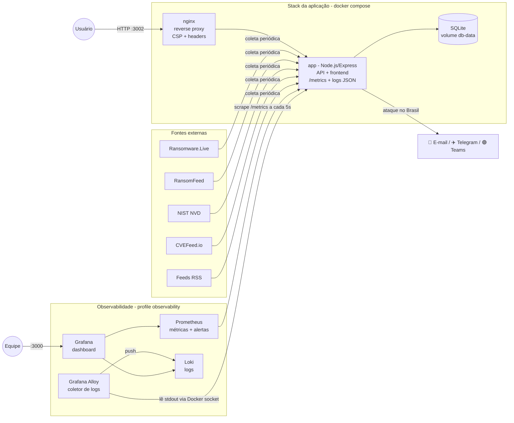
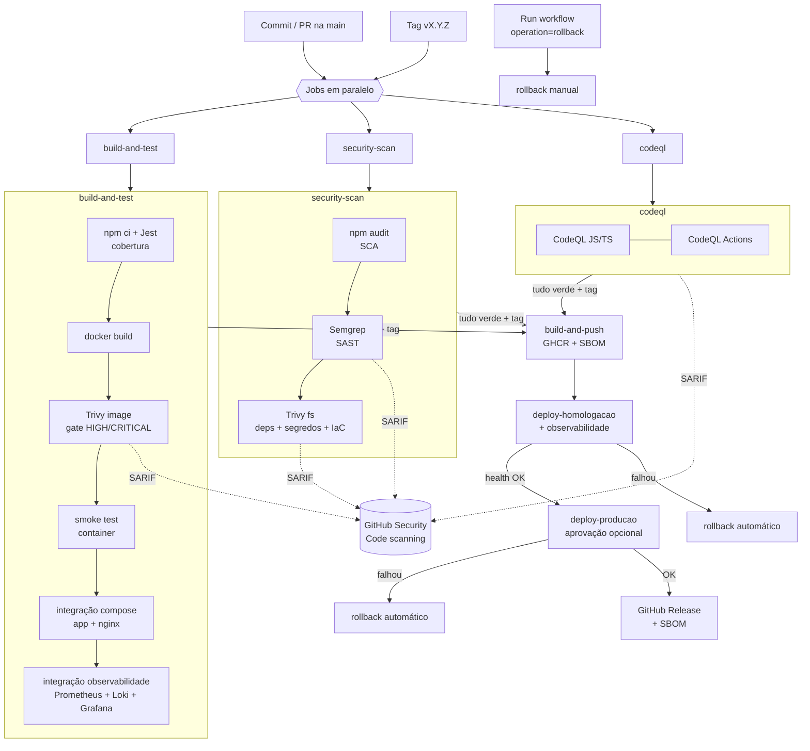

# 🛡️ Cyber Threat Hub

<div align="center">

### Plataforma de Cyber Threat Intelligence para monitoramento de ameaças cibernéticas


**Cyber Threat Intelligence • Ransomware • CVEs • Cybersecurity News • Alertas**

</div>

---

## 📑 Sumário

1. [Sobre o projeto](#-sobre-o-projeto)
2. [Organização da equipe](#-organização-da-equipe)
3. [Arquitetura da solução](#️-arquitetura-da-solução)
4. [Pipeline CI/CD + DevSecOps](#-pipeline-cicd--devsecops)
5. [Execução local](#-execução-local)
6. [Observabilidade e telemetria](#-observabilidade-e-telemetria)
7. [Segurança (DevSecOps)](#-segurança-devsecops)
8. [Entrega contínua, versionamento e rollback](#-entrega-contínua-versionamento-e-rollback)
9. [Estratégia Git](#-estratégia-git)
10. [Análise de riscos](#️-análise-de-riscos)
11. [Post-mortem](#-post-mortem-queda-do-servidor-ao-enviar-alertas-v110)
12. [Live demo](#-live-demo)
13. [Referência rápida](#-referência-rápida)

---

## 📖 Sobre o Projeto

O **Cyber Threat Hub** é uma plataforma de **Cyber Threat Intelligence (CTI)** que centraliza informações sobre ameaças cibernéticas: **ataques de ransomware, vulnerabilidades (CVEs), notícias de cibersegurança e incidentes que afetam o Brasil**.

Quando um novo ataque de ransomware contra uma organização brasileira é identificado, a plataforma gera alertas automáticos por **E-mail, Telegram e Microsoft Teams**.

### ✨ Funcionalidades

* 📊 **Dashboard** com métricas e gráficos de ameaças
* 📰 **CyberSec News** com notícias de cibersegurança via RSS
* 🚨 **Threat Feed** para monitoramento de ransomware, com detecção de vítimas no 🇧🇷 Brasil
* 🛡️ **Vulnerabilidades e CVEs** (NIST NVD + CVEFeed.io)
* 📧✈️🟣 **Alertas** por E-mail, Telegram e Microsoft Teams
* ⚙️ Painel para configuração das integrações
* 🔄 Atualização automática das fontes de inteligência

### 🌐 Fontes de inteligência

| Fonte               | Finalidade                            | Intervalo de coleta |
| ------------------- | ------------------------------------- | ------------------: |
| **Ransomware.Live** | Incidentes e vítimas de ransomware    |              30 min |
| **RansomFeed**      | Fonte complementar de ransomware      |              30 min |
| **NIST NVD**        | Vulnerabilidades e CVEs               |               1 h   |
| **CVEFeed.io**      | Informações complementares sobre CVEs |               1 h   |
| **Feeds RSS**       | Notícias de cibersegurança            |               2 h   |

As notícias vêm de **The Hacker News, CyberSecurity News, SecurityWeek, BleepingComputer, Krebs on Security, Dark Reading e CISO Advisor**.

### 🧰 Tecnologias

| Camada | Tecnologias |
|---|---|
| Frontend | HTML5, CSS3, JavaScript (vanilla), Chart.js, Font Awesome |
| Backend | Node.js 22, Express 5, Axios, Nodemailer, RSS Parser, SQLite3, Dotenv |
| Testes | Jest, Supertest, Sinon |
| Contêineres / IaC | Docker (multi-stage, non-root), Docker Compose (profiles), nginx |
| CI/CD | GitHub Actions, GitHub Container Registry (GHCR), GitHub Environments/Secrets |
| DevSecOps | Semgrep (SAST), CodeQL (SAST), npm audit (SCA), Trivy (dependências, segredos, IaC e contêiner, SBOM), Dependabot |
| Observabilidade | prom-client, Prometheus, Grafana, Loki, Grafana Alloy, logs JSON estruturados |

---

## 👥 Organização da equipe

O trabalho foi dividido nas funções sugeridas pela disciplina:

| Função | Responsável | Atribuições principais |
|---|---|---|
| **Desenvolvimento** | _(preencher)_ | Backend/Frontend, instrumentação da aplicação (métricas e logs), correções de segurança no código |
| **Qualidade (QA)** | _(preencher)_ | Suíte Jest/Supertest, gates do pipeline (testes, SAST, SCA), triagem dos achados de segurança |
| **Operações / Infraestrutura** | _(preencher)_ | Dockerfile, Docker Compose, pipeline de CI/CD, rollback, stack de observabilidade e dashboards |

O acompanhamento das fases está em [`docs/DEVOPS-CHECKLIST.md`](docs/DEVOPS-CHECKLIST.md).

---

## 🏗️ Arquitetura da solução



**Decisões de arquitetura**

* **nginx é o único serviço da aplicação exposto ao host.** Ele aplica headers de segurança (CSP, `X-Frame-Options`, `nosniff`...) e **bloqueia `/metrics`** para acesso externo; o Prometheus coleta direto do container pela rede interna `backend`.
* **Observabilidade como profile do Compose:** `docker compose up` sobe só a aplicação; `--profile observability` acrescenta Prometheus, Loki, Alloy e Grafana. Todas as configurações (data sources, dashboard, regras de alerta) são **versionadas como código** em [`observability/`](observability/).
* **Logs em stdout, coletados de fora:** a aplicação não conhece o Loki. Ela escreve JSON no stdout (12-factor) e o Alloy coleta os logs dos containers com a label `cth.logs=true`.
* **Imagem imutável e versionada:** a mesma imagem passa por CI, homologação e produção; a versão fica gravada na imagem e é exposta em `/api/health` e na métrica `app_info`.

---

## 🔁 Pipeline CI/CD + DevSecOps

Arquivo: [`.github/workflows/ci.yml`](.github/workflows/ci.yml)



| Job | Quando roda | O que faz | Bloqueia? |
|---|---|---|---|
| `build-and-test` | push/PR/tag | Testes Jest (17 testes, cobertura publicada), build da imagem, **Trivy na imagem**, smoke test, integração compose (app + nginx), verificação de que o nginx bloqueia `/metrics` e envia CSP, e **teste de integração da stack de observabilidade** | Sim |
| `security-scan` | push/PR/tag | **npm audit** (SCA), **Semgrep** (SAST), **Trivy fs** (vulnerabilidades em dependências, segredos vazados e misconfig do Dockerfile) | Sim (HIGH/CRITICAL) |
| `codeql` | push/PR/tag | **CodeQL** `security-extended` para JavaScript e para os próprios workflows do GitHub Actions | Via regra de proteção de branch |
| `build-and-push` | tags `vX.Y.Z` | Publica a imagem no GHCR com tags SemVer e gera o **SBOM CycloneDX** | Sim |
| `deploy-homologacao` | após o push | Deploy + health check + **rollback automático**; sobe também a stack de observabilidade e valida métricas e logs | Sim |
| `deploy-producao` | após homologação | Igual à homologação (porta 8080, Grafana em 3000) | Sim |
| `release` | após produção | Cria o GitHub Release com notas e o SBOM anexado | - |
| `rollback` | manual | Volta um ambiente para qualquer versão publicada | - |

---

## 🚀 Execução local

### Pré-requisitos

* **Docker Desktop** (ou Docker Engine + Compose v2), para a execução recomendada
* **Node.js 22+** e npm, apenas para rodar sem Docker ou executar os testes

### 1. Clonar e configurar

```bash
git clone https://github.com/ArthurNeiva017/Projeto-DevOps.git
cd Projeto-DevOps
cp .env.example .env      # preencha as chaves que quiser usar (todas são opcionais)
```

Variáveis do `.env` (nenhuma é obrigatória; sem a chave, a integração correspondente fica desativada):

| Variável | Uso |
|---|---|
| `SMTP_HOST`, `SMTP_PORT`, `SMTP_USER`, `SMTP_PASS`, `ALERT_EMAIL_TO` | Alertas por e-mail (no Gmail, use uma **Senha de App**) |
| `TELEGRAM_BOT_TOKEN`, `TELEGRAM_CHAT_ID` | Alertas pelo Telegram |
| `TEAMS_WEBHOOK_URL` | Alertas pelo Microsoft Teams |
| `RANSOMWARE_LIVE_API_KEY`, `CVEFEED_API_KEY` | Fontes de inteligência |
| `GRAFANA_ADMIN_PASSWORD` | Senha do admin do Grafana (sem ela, o Grafana usa `admin` e exige troca no 1º login) |
| `LOG_LEVEL` | `debug`, `info` (padrão), `warn` ou `error` |

> ⚠️ **Nunca publique o `.env`.** Ele está no `.gitignore` e no `.dockerignore`, e o Trivy procura segredos vazados em todo PR.

### 2a. Aplicação + observabilidade (recomendado)

```bash
docker compose --profile observability up -d --build
```

| Serviço | URL |
|---|---|
| Aplicação | <http://localhost:3002> |
| Grafana (dashboard abre direto, acesso anônimo somente leitura) | <http://localhost:3000> |
| Prometheus (métricas e alertas) | <http://localhost:9090> · <http://localhost:9090/alerts> |
| Health check | <http://localhost:3002/api/health> |

Para gerar tráfego e ver os gráficos se mexendo:

```bash
node scripts/gerar-trafego.js --duracao 120 --rps 8 --erros 0.15
```

Para verificar automaticamente se métricas, logs e o dashboard estão funcionando (o mesmo teste do CI):

```bash
bash scripts/verificar-observabilidade.sh cyber-threat-hub
```

### 2b. Só a aplicação

```bash
docker compose up -d --build        # app + nginx em http://localhost:3002
docker compose down                 # encerrar (-v apaga também os volumes)
```

### 2c. Sem Docker

```bash
cd backend
npm install
npm start                           # http://localhost:3001  (métricas em /metrics)
```

### 3. Testes

```bash
cd backend
npm test        # Jest + cobertura em backend/coverage
```

---

## 🔭 Observabilidade e telemetria

### Métricas (Prometheus)

A aplicação usa o [`prom-client`](https://github.com/siimon/prom-client) e expõe `GET /metrics` ([`backend/src/observability/metrics.js`](backend/src/observability/metrics.js)). O middleware HTTP registra **todas** as requisições com a rota **normalizada** (`/api/cves/:id`, e não cada CVE), para não explodir a cardinalidade.

| Sinal de ouro | Métrica | Uso no dashboard |
|---|---|---|
| **Tráfego** | `http_requests_total{method,route,status_code}` | req/s total, por rota e por status |
| **Erros** | `http_requests_total{status_code=~"5.."}`, `app_log_events_total{level}` | taxa de 5xx/4xx, eventos de log por nível |
| **Latência** | `http_request_duration_seconds` (histograma) | p50/p95/p99 e p95 por rota |
| **Saturação / recursos** | `process_cpu_seconds_total`, `process_resident_memory_bytes`, `nodejs_heap_size_*`, `nodejs_eventloop_lag_p99_seconds`, `http_requests_in_flight` | CPU, memória, heap, event loop |
| Versão | `app_info{version,git_sha}` | "Versão em execução" (muda a cada deploy/rollback) |
| Negócio | `cth_db_records{table}`, `cth_feed_sync_duration_seconds{source,status}`, `cth_alerts_sent_total{channel,result}` | registros no banco, coletas das fontes, alertas enviados |

### Logs estruturados (Loki)

[`backend/src/observability/logger.js`](backend/src/observability/logger.js) emite **uma linha JSON por evento**:

```json
{"time":"2026-11-17T12:44:05.061Z","level":"info","service":"cyber-threat-hub","version":"1.2.0","msg":"GET /api/noticias 200","type":"http_access","request_id":"cd3a9cf7-...","method":"GET","route":"/api/noticias","path":"/api/noticias","status":200,"duration_ms":11.09}
```

* Toda resposta recebe um header **`X-Request-Id`**, que também vai para o log, para correlacionar a requisição com o log.
* **Sem dados sensíveis:** chaves como `*pass*`, `*token*`, `*secret*`, `*api_key*`, `*webhook*` e `authorization` são substituídas por `[REDACTED]`; credenciais em URLs (`user:senha@host`), tokens `Bearer` e tokens de bot do Telegram são removidos das mensagens; o log de acesso não registra query string nem corpo da requisição. Tudo isso é coberto por testes.
* O **Grafana Alloy** coleta o stdout dos containers e envia ao **Loki**, transformando o campo `level` em label. Exemplos de consulta no Grafana (*Explore → Loki*):

```logql
{service="app", level="error"}
{service="app"} | json | route="/api/dashboard" | duration_ms > 500
{service="app"} | json | request_id="cd3a9cf7-..."
```

### Dashboard (Grafana)

Provisionado automaticamente a partir de [`observability/grafana/dashboards/cyber-threat-hub.json`](observability/grafana/dashboards/cyber-threat-hub.json):

1. **Visão geral:** Status (UP/DOWN), versão em execução, uptime, req/s, taxa de 5xx, latência p95
2. **Tráfego:** req/s por rota e por status HTTP
3. **Latência:** p50/p95/p99 e p95 por rota
4. **Erros:** taxa de 4xx/5xx e eventos de log por nível
5. **Consumo de recursos:** CPU, memória (RSS e heap) e event loop lag
6. **Threat Intelligence:** registros no banco, duração das coletas, alertas enviados
7. **Logs:** logs da aplicação, apenas avisos/erros e access log do nginx
8. **Anotações** roxas marcam cada deploy/restart da aplicação na linha do tempo

### SLOs e alertas

Regras em [`observability/prometheus/alerts.yml`](observability/prometheus/alerts.yml), visíveis em <http://localhost:9090/alerts>:

| Alerta | Condição | Severidade |
|---|---|---|
| `AplicacaoIndisponivel` | `up == 0` por 1 min | critical |
| `TaxaDeErrosAlta` | 5xx > 5% por 2 min (**SLO: < 5%**) | critical |
| `LatenciaAltaP95` | p95 > 1 s por 5 min (**SLO: p95 < 1 s**) | warning |
| `ConsumoDeMemoriaAlto` | RSS > 512 MiB por 5 min | warning |
| `ColetaDeFonteFalhando` | coleta de uma fonte com erro na última hora | warning |

---

## 🔐 Segurança (DevSecOps)

### Etapas automatizadas no pipeline

| Etapa | Ferramenta | Escopo | Política (gate) |
|---|---|---|---|
| **SAST** | Semgrep `p/javascript`, `p/nodejs`, `p/owasp-top-ten`, `p/secrets`, `p/dockerfile` | Código, Dockerfile, workflows | Bloqueia achados ERROR/HIGH/CRITICAL |
| **SAST semântico** | CodeQL `security-extended` (JS/TS e Actions) | Fluxo de dados (XSS, injeção, path traversal...) | Achados na aba *Security*; bloqueio via regra de branch |
| **SCA** | `npm audit` | Dependências de produção | Bloqueia HIGH/CRITICAL |
| **SCA + segredos + IaC** | Trivy `fs` | `package-lock.json`, segredos no repositório, Dockerfile | Bloqueia HIGH/CRITICAL com correção disponível |
| **Scan de contêiner** | Trivy `image` | Pacotes do SO e bibliotecas da imagem final | Bloqueia HIGH/CRITICAL com correção disponível |
| **SBOM** | Trivy (CycloneDX) | Imagem publicada | Anexado a cada GitHub Release |
| **Atualizações** | Dependabot (npm, Docker, Actions) | PRs semanais, com *cooldown* de 7 dias | Cada PR passa pelo pipeline completo |

Todos os relatórios são enviados em **SARIF** para *Security → Code scanning* do GitHub. Exceções aceitas conscientemente ficam em [`.trivyignore`](.trivyignore), sempre com justificativa e data de revisão.

### Achados corrigidos nesta fase

| Achado | Origem | Correção |
|---|---|---|
| 18 vulnerabilidades em dependências (2 críticas em `tar` via `sqlite3`, `axios`, `body-parser`, `nodemailer`...) | `npm audit` | `npm audit fix`, `sqlite3` 5 → 6, `nodemailer` 8 → 10. Dependências de produção: **0 vulnerabilidades** |
| 13 actions referenciadas por **tag mutável** (vetor do ataque ao `trivy-action`, CVE-2026-33634) | Semgrep | Todas as actions fixadas por **SHA de commit**; o Trivy roda pela imagem oficial com versão fixa, sem a action |
| **XSS armazenado:** títulos/resumos de feeds RSS e dados de APIs externas inseridos via `innerHTML` sem escape; `href` aceitando `javascript:` | Revisão de código | Funções `esc()`, `safeUrl()` e `htmlToText()` (DOMParser) no frontend + **Content-Security-Policy** no nginx |
| Parâmetro `:id` de `/api/cves/:id` usado sem validação na URL da API externa | Revisão de código | Validação `CVE-AAAA-NNNN` (retorna 400) |
| `/metrics` acessível publicamente | Revisão de arquitetura | Bloqueado no nginx (404); o Prometheus coleta pela rede interna |
| Imagem com Node 20 (fim de suporte em abril/2026), npm/yarn desnecessários em runtime | Trivy / revisão | Node 22 LTS, `apt-get upgrade` e remoção de npm/corepack/yarn da imagem final |
| Header `X-Powered-By: Express` | Boas práticas | Desabilitado |

### Gestão de segredos

Nenhuma credencial fica no código: tudo vem de `process.env`, do `.env` local (fora do Git e da imagem) ou dos **GitHub Secrets** dos environments `homologacao`/`producao`. O login no GHCR usa o `GITHUB_TOKEN` efêmero. Detalhes em [`docs/CD-ROLLBACK.md`](docs/CD-ROLLBACK.md#3-gestão-de-segredos).

---

## 📦 Entrega contínua, versionamento e rollback

* Toda tag `vX.Y.Z` (SemVer) dispara build, publicação no **GHCR** (`ghcr.io/arthurneiva017/projeto-devops:X.Y.Z`, `X.Y`, `X`, `sha-…`), deploy em **homologação** e **produção** e o **GitHub Release** com SBOM.
* Se o health check de uma nova versão falhar, o pipeline faz **rollback automático** para a última versão estável. Também é possível fazer rollback manual para qualquer versão publicada.
* Variáveis de repositório opcionais (*Settings → Secrets and variables → Actions → Variables*):
  * `DEPLOY_RUNNER`: label de um runner self-hosted para os deploys (ex.: `self-hosted`), deixando os ambientes e o Grafana acessíveis na máquina da demo. Padrão: `ubuntu-latest`.
  * `DEPLOY_OBSERVABILITY`: `true` (padrão) sobe e valida a stack de observabilidade em cada deploy.

```bash
git tag -a v1.2.0 -m "feat: DevSecOps e observabilidade"
git push origin v1.2.0
```

📄 Documentação completa, com o roteiro de simulação do rollback: [`docs/CD-ROLLBACK.md`](docs/CD-ROLLBACK.md)

---

## 🌿 Estratégia Git

* **Trunk-Based Development:** a `main` é a única branch de longa duração; mudanças entram por branches curtas (`feat/...`, `fix/...`) e Pull Request.
* **Proteção da `main`:** push direto bloqueado, PR obrigatório e os checks `build-and-test`, `security-scan` e `codeql` obrigatórios para o merge.
* **Conventional Commits** (`feat:`, `fix:`, `ci:`, `docs:`...), que também orientam o incremento SemVer. Veja [`CONTRIBUTING.md`](CONTRIBUTING.md).

---

## ⚠️ Análise de riscos

Escala: **P** = probabilidade, **I** = impacto (Baixo / Médio / Alto).

| # | Risco | P | I | Mitigação implementada | Risco residual / próximo passo |
|---|---|:-:|:-:|---|---|
| R1 | **Fontes externas indisponíveis ou lentas** (Ransomware.Live, NVD, RSS bloqueado pelo Cloudflare) | Alta | Médio | Coletas em paralelo com timeout e `Promise.allSettled`; falhas viram log + métrica `cth_feed_sync_duration_seconds{status="error"}` e o alerta `ColetaDeFonteFalhando` | Dados podem ficar desatualizados; adicionar circuit breaker por fonte |
| R2 | **XSS armazenado** via conteúdo de feeds de terceiros | Média | Alto | Escape de todo dado externo no frontend, `safeUrl()`, CSP restritiva no nginx | CSP ainda permite `style-src 'unsafe-inline'` (estilos inline do frontend) |
| R3 | **Dependência vulnerável ou comprometida** (supply chain) | Alta | Alto | npm audit + Trivy com gate, Dependabot com cooldown de 7 dias, actions fixadas por SHA, ferramentas com versão fixa, SBOM por release | Ataques *zero-day* em dependências ainda não catalogadas |
| R4 | **Vazamento de segredos** (SMTP, tokens de bot, webhooks) | Média | Alto | `.env` fora do Git/imagem, GitHub Secrets por environment, scan de segredos (Trivy/Semgrep), redação automática nos logs | `GET /api/settings` devolve tokens ao frontend sem autenticação: **adicionar autenticação ao painel de configurações** |
| R5 | **Deploy de versão defeituosa** | Média | Alto | Health check com versão esperada, homologação antes de produção, rollback automático, imagens imutáveis | Banco não tem migrações versionadas; rollback de esquema seria manual |
| R6 | **Perda de dados** do SQLite | Baixa | Médio | Volume nomeado `db-data`, dados reconstruíveis a partir das fontes | Sem backup agendado; SQLite não escala horizontalmente |
| R7 | **Alloy com acesso ao socket do Docker** | Baixa | Alto | Socket montado *read-only*, coleta restrita por label, stack de observabilidade sem portas além de Grafana/Prometheus | Em produção real, usar o driver de logs do Docker/Loki ou um agente com privilégio mínimo |
| R8 | **Runner self-hosted em repositório público** (opcional, para a demo) | Baixa | Alto | Deploys só em tags/execução manual, PRs de forks não rodam deploy, environments com *required reviewers* | Exigir aprovação para workflows de forks e usar runner efêmero |
| R9 | **Falha silenciosa** (app no ar, mas sem coletar dados ou enviar alertas) | Média | Médio | Métricas de negócio (`cth_db_records`, `cth_alerts_sent_total`), logs por nível, dashboard e alertas | Integrar o Alertmanager a um canal (Teams/Telegram) |

---

## 📝 Post-mortem: queda do servidor ao enviar alertas (v1.1.0)

> Formato *blameless*: o foco está no processo, não nas pessoas.

**Resumo.** Na versão `v1.1.0` (envio de alertas por e-mail, commit `6a48202`), o servidor **caía sempre que uma vítima brasileira era detectada**. O `threatFetcher.js` chamava `sendAttackNotification`, `sendTelegramNotification` e `sendTeamsNotification` **sem importá-las**. O `ReferenceError` virava uma *unhandled rejection* e encerrava o processo Node.js.

| Item | Detalhe |
|---|---|
| **Impacto** | Aplicação indisponível após cada coleta com vítima no Brasil. Nenhum alerta (e-mail/Telegram/Teams) foi enviado; justamente a funcionalidade principal ficou fora do ar |
| **Detecção** | Manual, pela queda do processo/container. **Não havia métricas nem logs centralizados** para mostrar a causa |
| **Duração** | De `v1.1.0` (03/11/2026 09:39) até a correção `v1.1.1` (03/11/2026 12:59, commit `1db3a1c`): ~3h20 |
| **Causa raiz** | Funções usadas sem `require`, num caminho de código (vítima BR) que **nenhum teste cobria**. JavaScript não acusa referência indefinida antes da execução |
| **Por que passou pelo CI?** | A suíte testava só as rotas HTTP; o fluxo de alertas dependia de dados reais das APIs e não era exercitado |

**Linha do tempo (03/11/2026)**

1. 09:39 - merge de `feat: Envio de ataques por E-mail` (v1.1.0)
2. Coleta periódica encontra vítima brasileira → `ReferenceError` → processo encerra
3. 12:59 - `fix: corrige queda do servidor ao enviar alertas` (v1.1.1): imports corrigidos, canais opcionais carregados com segurança, envio em paralelo com `try/catch` por canal (`safeNotify`)
4. 13:12 - pipeline de deploy passa a tolerar versão anterior quebrada ao simular o ambiente (commit `54a41e0`)

**O que funcionou:** o rollback por imagem versionada permitia voltar para `v1.0.0` rapidamente; o padrão Conventional Commits deixou a correção rastreável.

**O que não funcionou:** ausência de testes no fluxo de alertas; nenhuma visibilidade de erros (logs só no console do container, sem métricas).

**Ações corretivas**

| Ação | Status |
|---|---|
| Isolar falhas por canal de alerta (`safeNotify`) | ✅ v1.1.1 |
| Logs estruturados centralizados no Loki com nível `error` pesquisável | ✅ v1.2.0 |
| Métrica `cth_alerts_sent_total{channel,result}` e painel de alertas no Grafana | ✅ v1.2.0 |
| Handler global de `unhandledRejection` registrando no log estruturado | ✅ v1.2.0 |
| Alerta `AplicacaoIndisponivel` (up == 0) no Prometheus | ✅ v1.2.0 |
| SAST (Semgrep/CodeQL) bloqueando o merge em achados graves | ✅ v1.2.0 |
| Lint com `no-undef` (ESLint) no CI, que pegaria esse erro antes da execução | 🔲 backlog |
| Teste automatizado do fluxo "vítima BR → alertas" com as APIs mockadas | 🔲 backlog |

---

## 🎬 Live demo

Roteiro completo, passo a passo, em [`docs/LIVE-DEMO.md`](docs/LIVE-DEMO.md):

**Commit → Testes/SAST → Build/Deploy → Visualização no Dashboard**

---

## 📚 Referência rápida

### Endpoints

```text
GET  /api/dashboard      métricas e gráficos do painel
GET  /api/noticias       notícias (RSS)
GET  /api/ameacas        ameaças de ransomware
GET  /api/cves           vulnerabilidades
GET  /api/cves/:id       detalhe de uma CVE (formato CVE-AAAA-NNNN)
GET  /api/settings       configurações de alerta
POST /api/settings       atualiza configurações de alerta
GET  /api/health         health check (status, versão, uptime)
GET  /metrics            métricas Prometheus (bloqueado no nginx; uso interno)
```

### Estrutura

```text
Projeto-DevOps/
├── backend/
│   ├── src/
│   │   ├── database/            # SQLite (NOTICIA, AMEACA, CVE, METRICA)
│   │   ├── observability/       # logger.js (logs JSON) e metrics.js (Prometheus)
│   │   ├── services/            # coletores (RSS, ameaças, CVEs) e alertas
│   │   └── server.js
│   └── tests/                   # api.test.js, observability.test.js
├── frontend/                    # HTML, CSS e JS (vanilla)
├── nginx/nginx.conf             # reverse proxy, CSP, bloqueio de /metrics
├── observability/
│   ├── prometheus/              # scrape + regras de alerta
│   ├── loki/                    # armazenamento de logs
│   ├── alloy/                   # coletor de logs dos containers
│   └── grafana/                 # data sources + dashboard (provisionados)
├── scripts/
│   ├── gerar-trafego.js         # carga sintética para a demo
│   └── verificar-observabilidade.sh
├── .github/
│   ├── workflows/ci.yml         # CI/CD + DevSecOps
│   ├── actions/deploy/          # deploy/rollback simulado (composite action)
│   └── dependabot.yml
├── docs/                        # CD-ROLLBACK.md, LIVE-DEMO.md, DEVOPS-CHECKLIST.md
├── Dockerfile
├── docker-compose.yml
├── .trivyignore
└── .env.example
```

### Banco de dados

**SQLite**, criado automaticamente, com as tabelas `NOTICIA`, `AMEACA` (inclui país e status de envio de alerta), `CVE` (inclui cache do CVEFeed) e `METRICA`. No Docker fica no volume `db-data` (`/app/data`).

---

## 🎓 Finalidade

O **Cyber Threat Hub** foi desenvolvido para fins acadêmicos, educacionais e de pesquisa em **Cyber Threat Intelligence e Segurança da Informação**. As informações vêm de APIs e fontes públicas e devem ser usadas exclusivamente em atividades legítimas de monitoramento, pesquisa e segurança defensiva.

## 👨‍💻 Autor

**Arthur Barroso Neiva**: Cybersecurity, Cyber Threat Intelligence e Desenvolvimento de Software.
GitHub: **[@ArthurNeiva017](https://github.com/ArthurNeiva017)**

---

<div align="center">

### ☁️ Cyber Threat Hub

**Monitorar • Analisar • Detectar • Alertar**

</div>
