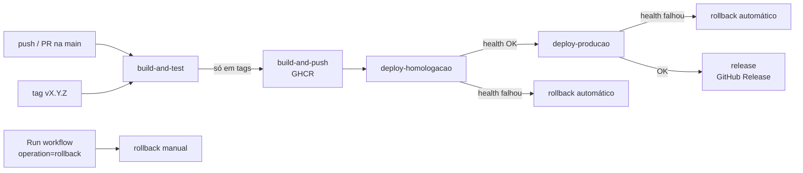

# Entrega Contínua (CD), Versionamento e Rollback

Documentação da Fase A2: IaC e Continuous Delivery do **Cyber Threat Hub**.

## 1. Visão geral do pipeline

Arquivo: [`.github/workflows/ci.yml`](../.github/workflows/ci.yml)



| Job | Quando roda | O que faz |
|---|---|---|
| `build-and-test` | push/PR na `main`, tags | `npm ci`, testes Jest, `docker compose config`, build da imagem, smoke test do container e teste de integração com a stack completa (app + nginx) via `docker compose` |
| `build-and-push` | tags `vX.Y.Z` | Valida SemVer, gera as tags da imagem e publica no **GitHub Container Registry** |
| `deploy-homologacao` | após o push | Sobe a versão estável anterior (simula o ambiente existente), faz deploy da nova versão e executa **rollback automático** se o health check falhar |
| `deploy-producao` | após homologação OK | Igual à homologação, na porta 8080. Pode exigir aprovação manual (*Required reviewers* no environment) |
| `release` | após produção OK | Cria o **GitHub Release** `vX.Y.Z` com notas geradas a partir dos commits |
| `rollback` | manual (`workflow_dispatch`) | Volta um ambiente para uma versão SemVer informada, após conferir que a imagem existe no registry |

## 2. Infraestrutura como Código

| Arquivo | Função |
|---|---|
| [`Dockerfile`](../Dockerfile) | Build multi-stage (`deps` → `runtime`), apenas dependências de produção, usuário `node` sem privilégios, labels OCI com versão e commit, `HEALTHCHECK` em `/api/health` |
| [`.dockerignore`](../.dockerignore) | Mantém `.env`, banco local, testes, docs e `.git` fora da imagem |
| [`docker-compose.yml`](../docker-compose.yml) | Serviço `app` (Node.js + SQLite em volume `db-data`) e `nginx` (reverse proxy, único serviço exposto), rede interna `backend` e health checks |
| [`nginx/nginx.conf`](../nginx/nginx.conf) | Proxy reverso com headers de segurança e gzip |
| [`.github/actions/deploy/action.yml`](../.github/actions/deploy/action.yml) | Action local reutilizada pelo pipeline para o deploy (e o rollback) de uma versão num ambiente simulado |

### Ambientes simulados

Cada ambiente é um **projeto docker compose isolado** no runner do GitHub Actions, com containers, rede e volume próprios:

| Ambiente | Projeto compose | Porta | GitHub Environment |
|---|---|---|---|
| Homologação | `cth-homologacao` | 8081 | `homologacao` |
| Produção | `cth-producao` | 8080 | `producao` |

A action de deploy faz `docker compose pull` e `up -d --wait`, que aguarda os health checks. Depois confere, através do nginx, se `/api/health` responde com a **versão esperada**. O estado de cada ambiente fica em `.deploy/<ambiente>/`:

- `current`: última versão implantada com sucesso (um deploy que falhou **não** altera este arquivo)
- `previous`: versão estável anterior
- `history.log`: auditoria de `DEPLOY_OK`, `DEPLOY_FAILED`, `ROLLBACK_START` e `ROLLBACK_OK`

## 3. Gestão de segredos

- **Nenhuma credencial fica no código-fonte.** Todas as chaves (SMTP, Telegram, Teams, Ransomware.Live, CVEFeed) são lidas de `process.env`. Se uma chave não estiver definida, a integração correspondente é desativada, sem usar valor padrão.
- **Local:** copie [`.env.example`](../.env.example) para `.env` na raiz. O `.env` está no `.gitignore` e no `.dockerignore`.
- **Pipeline:** os valores vêm dos **GitHub Secrets** de cada *Environment* (`Settings > Environments > homologacao | producao > Environment secrets`) e são injetados como variáveis de ambiente nos jobs de deploy. O docker compose os repassa ao container.
- **Registry:** o login no GHCR usa o `GITHUB_TOKEN` efêmero do próprio Actions (permissão `packages: write`). Não existe senha pessoal armazenada.

Secrets a cadastrar em cada environment (todos opcionais, a aplicação sobe sem eles):

```
SMTP_HOST  SMTP_PORT  SMTP_USER  SMTP_PASS  ALERT_EMAIL_TO
TELEGRAM_BOT_TOKEN  TELEGRAM_CHAT_ID
RANSOMWARE_LIVE_API_KEY  CVEFEED_API_KEY  TEAMS_WEBHOOK_URL
```

## 4. Versionamento semântico

As versões seguem **SemVer** (`MAJOR.MINOR.PATCH`) e são definidas por **tags Git** `vX.Y.Z`. O pipeline rejeita tags fora do padrão.

| Tipo de mudança (Conventional Commits) | Incremento |
|---|---|
| `fix:` | PATCH: `1.0.0` → `1.0.1` |
| `feat:` | MINOR: `1.0.1` → `1.1.0` |
| `feat!:` / `BREAKING CHANGE:` | MAJOR: `1.1.0` → `2.0.0` |

Para a tag `v1.2.3`, a imagem é publicada como:

```
ghcr.io/arthurneiva017/projeto-devops:1.2.3
ghcr.io/arthurneiva017/projeto-devops:1.2
ghcr.io/arthurneiva017/projeto-devops:1
ghcr.io/arthurneiva017/projeto-devops:sha-<commit>
```

A versão também é gravada dentro da imagem (label `org.opencontainers.image.version` e variável `APP_VERSION`) e exposta em `GET /api/health`. Assim dá para confirmar qual versão está rodando em cada ambiente.

Para publicar uma versão:

```bash
git checkout main && git pull
git tag -a v1.1.0 -m "feat: health check e rollback"
git push origin v1.1.0
```

## 5. Rollback

### 5.1 Rollback automático

Quando o deploy da nova versão falha (container *unhealthy*, health check externo falhando ou versão divergente), o step **"Preparar rollback"** lê a versão registrada em `.deploy/<ambiente>/current`, que é a última que passou no health check, e o step **"Rollback automático"** reimplanta essa versão usando a mesma action de deploy. O job termina como **falho**, para deixar o incidente visível, e a promoção para produção é **bloqueada**.

### 5.2 Rollback manual

`Actions > CI/CD Pipeline > Run workflow`, com `operation = rollback`, o ambiente escolhido e a versão (ex.: `1.0.0`). O job confere se a imagem existe no GHCR antes de reimplantá-la. Como as imagens são imutáveis e versionadas, qualquer versão publicada pode ser restaurada.

### 5.3 Simulação documentada (roteiro)

A variável `SIMULATE_FAILURE=true` faz o `/api/health` responder `503`, simulando uma versão defeituosa.

**Pré-requisito:** ter ao menos duas versões publicadas (ex.: `v1.0.0` e `v1.1.0`).

1. Publicar `v1.0.0` (`git tag -a v1.0.0 -m "release 1.0.0" && git push origin v1.0.0`) e aguardar o pipeline terminar verde.
2. Publicar `v1.1.0` da mesma forma.
3. Em **Actions > CI/CD Pipeline > Run workflow**:
   - *Use workflow from:* **Tags → v1.1.0**
   - *operation:* `deploy`
   - *simulate_failure:* ✅
4. Resultado esperado em `deploy-homologacao`:
   - "Simular ambiente com a versão estável atual" sobe a **1.0.0** (`DEPLOY_OK`). Se a versão anterior estiver quebrada, o step só emite um aviso e o pipeline segue
   - "Deploy da nova versão" sobe a **1.1.0**, o health check retorna 503 e o step falha (`DEPLOY_FAILED`)
   - "Rollback automático" reimplanta a **1.0.0** (`ROLLBACK_START` → `DEPLOY_OK` → `ROLLBACK_OK`)
   - `deploy-producao` **não executa**
5. O *Summary* da execução mostra o `history.log`, por exemplo:

```
2026-11-04T13:00:01Z DEPLOY_OK version=1.0.0 env=homologacao
2026-11-04T13:01:15Z DEPLOY_FAILED version=1.1.0 env=homologacao
2026-11-04T13:01:16Z ROLLBACK_START version=1.0.0 env=homologacao
2026-11-04T13:01:40Z DEPLOY_OK version=1.0.0 env=homologacao
2026-11-04T13:01:40Z ROLLBACK_OK version=1.0.0 env=homologacao
```

6. (Opcional) Demonstrar o rollback manual: *Run workflow* → `operation = rollback`, `environment = producao`, `version = 1.0.0`.

### 5.4 Reproduzindo localmente

O mesmo fluxo pode ser reproduzido só com o docker compose, alterando `IMAGE_TAG`:

```bash
docker build --build-arg APP_VERSION=1.0.0 -t cyber-threat-hub:1.0.0 .
docker build --build-arg APP_VERSION=1.1.0 -t cyber-threat-hub:1.1.0 .

# versão estável
IMAGE_TAG=1.0.0 docker compose up -d --no-build --wait
curl http://localhost:3002/api/health        # {"status":"ok","version":"1.0.0"}

# versão defeituosa: o --wait falha porque o app fica unhealthy
IMAGE_TAG=1.1.0 SIMULATE_FAILURE=true docker compose up -d --no-build --wait

# rollback: volta para a imagem estável
IMAGE_TAG=1.0.0 docker compose up -d --no-build --wait
curl http://localhost:3002/api/health        # {"status":"ok","version":"1.0.0"}

docker compose down -v                       # limpeza
```

## 6. Evidências

Anexe aqui os prints da execução no GitHub Actions:

- [ ] Pipeline verde da tag `v1.0.0` (build, push, homologação, produção, release)
- [ ] Pacote no GHCR com as tags `1.0.0`, `1.0`, `1` e `sha-…`
- [ ] Execução com `simulate_failure` mostrando o rollback automático e o `history.log` no Summary
- [ ] GitHub Releases listando as versões
- [ ] Environments `homologacao` e `producao` com os secrets cadastrados (nomes apenas)
